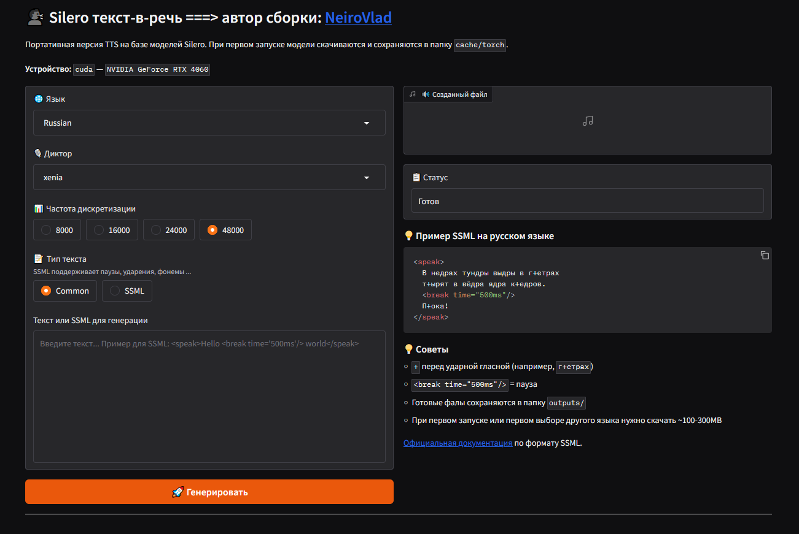

<div align="center">

# Silero TTS Portable

**Портативный текст-в-речь для Windows — Silero, установка в один клик, 100% офлайн.**

[](https://github.com/vlad-ir/Silero-TTS-Portable/stargazers)
[](LICENSE)
[](https://github.com/vlad-ir/Silero-TTS-Portable/commits)
[](https://github.com/vlad-ir/Silero-TTS-Portable/releases)



</div>

Silero TTS — высококачественная нейросеть для синтеза речи от [Silero](https://github.com/snakers4/silero-models), поддерживающая множество языков и голосов. Полностью русифицированный интерфейс.

## Возможности

- Синтез речи из текста с высоким качеством
- Поддержка **SSML** — ударения, паузы, интонации
- Автоматическая расстановка ударений и буквы `ё` (русский язык)
- **6 языков**: Русский, Английский, Немецкий, Испанский, Французский, Украинский
- **20+ голосов** на выбор
- Работа на **GPU** (CUDA) и **CPU**
- Полностью русскоязычный интерфейс
- Тёмная тема интерфейса
- Автоматическое открытие в браузере
- Портативность — все файлы в одной папке
- Сохранение сгенерированных файлов в папку `outputs/`
- Ускоренная установка через UV package manager

## Системные требования

- Windows 10/11 (64-bit)
- NVIDIA GPU с поддержкой CUDA (рекомендуется для скорости)
- Или CPU (медленнее, но работает)
- 4GB+ RAM
- 5GB свободного места на диске

### Рекомендуемые видеокарты

| Серия | CUDA версия | Рекомендуется |
|-------|-------------|---------------|
| GTX 10xx (Pascal) | CUDA 11.8 | Да |
| RTX 20xx (Turing) | CUDA 11.8 | Да |
| RTX 30xx (Ampere) | CUDA 12.6 | Да |
| RTX 40xx (Ada Lovelace) | CUDA 12.8 | Да |
| RTX 50xx (Blackwell) | CUDA 12.8 | Да |

## Установка

### Быстрая установка (рекомендуется)

1. Скачайте архив `Silero_TTS_Portable.zip` из [релизов](https://github.com/vlad-ir/Silero-TTS-Portable/releases)
2. Распакуйте в любую папку в корне диска. Название папки латиницей, без пробелов (например `D:\Silero`)
3. Запустите `Silero.bat`
4. Выберите пункт **2. Install/Re-install Silero**
5. Дождитесь завершения установки

### Установка из исходников

1. Клонируйте репозиторий: `git clone https://github.com/vlad-ir/Silero-TTS-Portable.git`
2. Запустите `Silero.bat`
3. Выберите пункт **2. Install/Re-install Silero**
4. Дождитесь завершения установки

Установщик автоматически скачает и настроит:
- Miniconda (портативный Python)
- PyTorch с поддержкой CUDA 12.8
- UV package manager (ускоренная установка зависимостей)
- PortableGit
- Все необходимые Python-библиотеки

## Запуск

1. Запустите `Silero.bat`
2. Выберите пункт **1. Start Silero TTS**
3. Приложение автоматически откроется в браузере
4. Выберите язык, голос и частоту дискретизации
5. Введите текст или SSML
6. Нажмите **🚀 Синтезировать**

## SSML — расширенные возможности

Silero поддерживает [SSML-разметку](https://github.com/snakers4/silero-models/wiki/SSML) для тонкого контроля над синтезом:

### Ударения (работают в Common и SSML режимах)
```xml
<speak>В недрах тундры выдры в г+етрах т+ырят в вёдра ядра к+едров.</speak>
```
Символ `+` перед гласной ставит ударение.

### Паузы
```xml
<speak>Привет! <break time="500ms"/> Как дела?</speak>
```

### Полный пример
```xml
<speak>
  Добро пожаловать в Silero TTS!
  <break time="300ms"/> 
  Это демонстрация возможностей SSML.
  <break time="500ms"/> 
  Мы можем ставить ударения: м+олоко, к+арандаш.
  <break time="200ms"/> 
  И делать паузы между фразами.
</speak>
```

## Голоса

### Русский (v5_5_ru)
| Голос | Описание |
|-------|----------|
| `aidar` | Мужской, нейтральный |
| `baya` | Женский, мягкий |
| `kseniya` | Женский, деловой |
| `xenia` | Женский, дружелюбный |
| `eugene` | Мужской, глубокий |
| `random` | Случайный голос |

### Английский (v5_en)
| Голос | Описание |
|-------|----------|
| `lj_16khz` | Женский, нейтральный |

### Другие языки
- **Немецкий**: `bernd_ungerer`
- **Испанский**: `es_0`, `es_1`, `es_2`
- **Французский**: `fr_0`, `fr_1`, `fr_2`
- **Украинский**: `mykyta`

## Поддерживаемые частоты дискретизации

- **8000 Hz** — телефонное качество, минимальный размер файла
- **16000 Hz** — стандартное качество
- **24000 Hz** — хорошее качество
- **48000 Hz** — максимальное качество (рекомендуется)

## Структура папок

```
Silero-TTS-Portable/
├── Silero.bat          # Главный файл запуска
├── silero_ui.py        # Интерфейс Gradio
├── tools/              # Портативные инструменты
│   ├── miniconda/      # Python окружение
│   ├── PortableGit/    # Git
│   └── uv.exe          # UV package manager
├── .venv/              # Виртуальное окружение Python
├── cache/              # Кэш моделей и пакетов
│   ├── torch/          # Кэш моделей Silero
│   ├── huggingface/    # Кэш HuggingFace
│   └── uv/             # Кэш UV
├── outputs/            # Сгенерированные аудиофайлы
└── temp_output.wav     # Временный файл (последняя генерация)
```

## Изоляция

Приложение полностью изолировано и не создает файлы за пределами своей папки:
- Все модели в `cache/torch/`
- Все кэши в `cache/`
- Сгенерированные файлы в `outputs/`
- Системные переменные окружения не изменяются

## Решение проблем

### Ошибка "CUDA out of memory"
- Уменьшите частоту дискретизации до 24000 или 16000 Hz
- Закройте другие приложения, использующие GPU
- Перезапустите приложение

### Модель загружается медленно
- При первом запуске модель скачивается (~100-300MB на язык)
- Последующие запуски будут быстрее (модель кэшируется)

### Ошибка "No module named 'soundfile'"
- Запустите `Silero.bat` → **3. Update Silero**
- Или переустановите: **2. Install/Re-install Silero**

### Браузер не открывается автоматически
- Откройте вручную: http://127.0.0.1:8891
- Проверьте, что порт 8891 не занят другим приложением

### Ошибка при синтезе
- Проверьте, что текст не пустой
- Для SSML проверьте правильность XML-разметки
- Убедитесь, что выбранный голос поддерживает выбранный язык

## Горячие клавиши

- **Ctrl+C** в окне консоли — остановить приложение
- **F5** в браузере — обновить интерфейс

## Благодарности

- **Silero Models** — [github.com/snakers4/silero-models](https://github.com/snakers4/silero-models)
- **Gradio** — [gradio.app](https://gradio.app)
- **PyTorch** — [pytorch.org](https://pytorch.org)
- **UV** — [astral.sh/uv](https://astral.sh/uv)
- **NeuroSenko** ([huggingface.co/spaces/NeuroSenko](https://huggingface.co/spaces/NeuroSenko/tts-silero/tree/main)) — демо-версия Silero

## Лицензия

Данный проект распространяется под лицензией MIT.
Модели Silero распространяются под лицензией [CC BY-NC-SA 4.0](https://creativecommons.org/licenses/by-nc-sa/4.0/).

## Авторы

- **NeiroVlad** ([github.com/vlad-ir](https://github.com/vlad-ir)) — автор портабельной сборки
- **oti.by** ([t.me/vlad_vlk](https://t.me/vlad_vlk)) — [oti.by](https://oti.by) — нейронные сети и умные чат-боты для бизнеса
- **Нейронки в бизнесе и в жизни** ([t.me/neiro_com](https://t.me/neiro_com)) — промпты, примеры, советы и т.д. 


## Поддержать автора

Если проект оказался полезным, поставьте ⭐ на GitHub!

**Карта UnionPay:** `6229644000154242`

---

<div align="center">

**[⬆ Наверх](#silero-tts-portable)**

</div>
